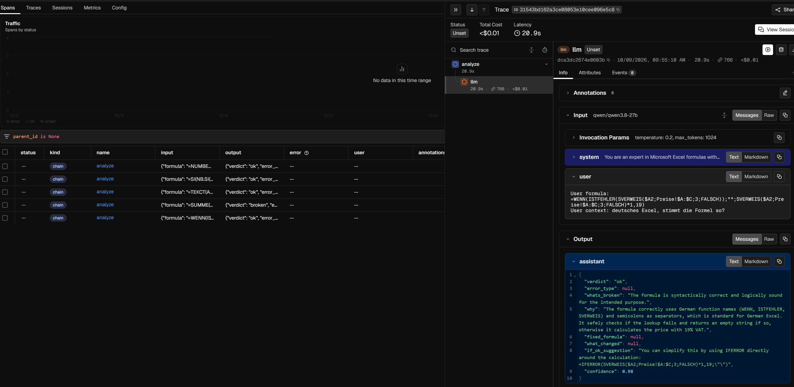

[English](README.md) | **Русский** | [日本語](README.ja.md)

# FormulaFix

Вставьте сломанную формулу Excel или Google Sheets (`#REF!`, `#VALUE!`, `#N/A`, циклическая ссылка, опечатка в имени функции) и получите объяснение простым языком, что не так, и исправленную формулу.

Этот репозиторий — LLM-ядро небольшого продукта, перенесённое с Node/Next.js на Python/FastAPI и перестроенное вокруг **измерений**: золотой датасет с эталонными диагнозами, оценочный стенд, хранение прогонов в Postgres, промпты под git. Сам продукт закрыт (вендоры таблиц выпустили встроенных помощников по исправлению формул); этот репозиторий — про инженерию.

Та же дисциплина, что в [RAG-проекте](https://github.com/Ragebeat/rag-japanese-labour-law): **каждое изменение подтверждено числом на фиксированном датасете, критерии успеха записаны до прогонов, а одно сравнение двух прогонов LLM — не вывод.**

> **Точность verdict 0.879 у DeepSeek V4.1 Flash против 0.742 у Qwen на золотом наборе и 0.781 против 0.648 на 35 валидационных кейсах, под которые промпт не подгонялся. Оба эксперимента с промптом остались в пределах разброса между прогонами и не приняты.**
>
> **Статус: завершён.** Готовы стенд, золотой набор (80 кейсов), отдельный валидационный набор (35 кейсов), базовая линия, два заранее зарегистрированных эксперимента (оба измерены, ни один не принят) и трейсинг. Сервис не развёрнут; репозиторий — про измерения.


**Содержание:** [Результаты](#результаты) · [Архитектура](#архитектура) · [Метод](#метод) · [Что не сработало](#что-не-сработало) · [Трейсинг](#трейсинг) · [Оговорки](#оговорки) · [Откуда цифры](#откуда-цифры) · [Запуск](#запуск) · [План](#план) · [Другие проекты](#другие-проекты) · [Лицензия](#лицензия)

---

## Результаты

80 кейсов (60 dev + 20 held-out). Каждая строка — среднее по 3 прогонам, в скобках разброс min–max, плюс контрольные прогоны предыдущей конфигурации (модель шумит даже при низкой температуре).

| Конфигурация | verdict | error type | fix correct | сбойных вызовов | p50 задержка |
|---|---|---|---|---|---|
| Промпт из Node, `qwen/qwen3.8-27b` на Groq, T=0.2 (3 прогона) | 0.742 (0.725–0.762) | 0.691 (0.691–0.691) | 0.448 (0.418–0.473), нижняя оценка (аудит судьи ниже) | 1 из 240 (обрыв по `max_tokens`) | 0.55 с |
| Тот же промпт, `deepseek/deepseek-v4.1-flash` через OpenRouter (DeepInfra fp8), reasoning выключен, T=0.2 (3 прогона) | 0.879 (0.850–0.900) | 0.776 (0.764–0.782) | 0.582 (0.564–0.600), нижняя оценка (аудит судьи ниже) | 1 из 240 (нарушение схемы) | 3.1 с, около $0.009 за прогон |
| То же, DeepSeek, `temperature` 0 вместо 0.2 (3 прогона) | 0.862 (0.850–0.875) | 0.752 (0.745–0.764) | 0.564 (0.545–0.582), нижняя оценка (аудит судьи ниже) | 0 из 240 | 3.1 с, около $0.008 за прогон |
| DeepSeek, T=0.2, правило о разделителях переписано с зависимостью от локали (промпт `v2_locale`, не принят, 3 прогона) | 0.892 (0.888–0.900) | 0.776 (0.764–0.782) | не оценивалось судьёй | 1 из 240 (невалидный JSON) | 3.7 с, около $0.009 за прогон |

Первые две строки используют идентичные промпт и кейсы; различаются только модель и провайдер. Лучшая конфигурация — DeepSeek при T=0.2 с исходным промптом: ни один эксперимент не превзошёл её больше, чем на разброс между прогонами (подробности в разделе «Что не сработало» и в [EXPERIMENTS.md](EXPERIMENTS.md)).

Неверно в каждом прогоне (систематические ошибки): 15 из 80 кейсов у Qwen, 6 из 80 у DeepSeek; 3 кейса категории локали (g075, g077, g078) неверны у обеих моделей. Кейсы, у которых вердикт или тип ошибки меняется между прогонами (шум): 18 у Qwen, 9 у DeepSeek. У DeepSeek систематическая часть — не более 7.5 процентных пунктов ошибки по verdict, поэтому на этом наборе изменение промпта по verdict почти не отличить от шума; запас лежит в error type и в корректности исправления.

### Валидационный набор (35 кейсов, под которые промпт никогда не подгонялся)

Написан после заморозки золотого набора, нацелен на слабые места, найденные там (локаль, рабочая формула рядом с жалобой пользователя, корректный, но необычный синтаксис, обычные ошибки с подвохом). Разметка проверена вручную до заморозки: все спорные кейсы, выборка из восьми, один кейс проверен в Excel 2013; два кейса локали переписаны так, чтобы называть локаль. Точность verdict, среднее по 3 прогонам, тот же промпт, `temperature` 0.2:

| Группа (кейсов) | `qwen/qwen3.8-27b` (Groq) | `deepseek/deepseek-v4.1-flash` (DeepInfra fp8) |
|---|---|---|
| все (35) | 0.648 (0.629–0.686) | 0.781 (0.771–0.800) |
| locale (12) | 0.861 | 0.861 |
| hidden_cause (8) | 0.458 | 0.500 |
| valid_unusual (8) | 0.417 | 0.875 |
| hidden_cause: причина названа в объяснении (8) | 0.792 | 0.917 |
| hidden_cause: рекомендовано допустимое действие (8) | 0.375 | 0.458 |
| generic (7) | 0.762 | 0.857 |
| стабильность | 0.829 | 0.943 |

Разрыв между моделями сохраняется на новых данных (13 пунктов против 14 на золотом наборе, диапазоны не пересекаются). Обе модели справляются хуже, чем на золотом наборе (DeepSeek 0.879 → 0.781), так что золотые числа — оптимистичные. Разрыв почти целиком в `valid_unusual`: Qwen называет корректные, но необычные формулы сломанными. `locale` и `hidden_cause` низкие у обеих моделей, и падают одни и те же кейсы (v010, v013, v017, v021, v034) — это указывает на задачу и правила промпта, а не на модель. Один кейс — это 12.5 пункта в группе из 8, поэтому групповые числа — лишь ориентир. Для `hidden_cause` verdict занижает качество продукта: формула верна, настоящая причина в другом месте, и модели часто называют причину, но всё равно отвечают `ok`. Судья из другого семейства моделей читает объяснение и оценивает два пункта отдельно: названа ли причина и рекомендовано ли допустимое действие. (Рубрика написана после того, как была просмотрена первая, объединённая версия, строже своего названия; обе хранятся в базе.) Причина названа в 0.917 (DeepSeek) и 0.792 (Qwen) ответов, но допустимое действие рекомендовано лишь в 0.458 и 0.375. Модели в основном понимают, что не так; слабое место — подсказать пользователю, что делать: например, повторяют обходной путь, который пользователь уже нашёл, или переписывают корректную формулу.

Результаты на held-out выше, чем на dev, у обеих моделей (на 8–10 пунктов), поэтому абсолютное число на held-out несопоставимо с dev, сравнимы только изменения между конфигурациями.

### До появления золотого набора

В Node-версии был скрипт на 20 кейсов с мягкими ожиданиями (списки допустимых значений, «не проверяется»), и промпт подгонялся под эти же 20 кейсов. На текущей модели три прогона дали 17/20, 16/20, 16/20 (в третьем один вызов упал с HTTP 502). Кейсы №1, №2 и №10 падали в каждом прогоне; №18 мигал между прогонами. Это контекст, а не базовая линия: кейсы были видны при настройке промпта, поэтому в золотом наборе они остаются только как *dev*.

---

## Архитектура

```
POST /analyze  {formula, context, dialect}
  ↓ проверка входа (formula 3–2000 символов, context ≤ 2000)
  ↓ промпт из prompts/<version>.txt (под git, sha256 записывается с каждым прогоном)
  ↓ OpenAI-совместимый chat-вызов (сегодня Groq; любой провайдер через env)
  ↓ восстановление JSON (как в Node-оригинале) → модель Pydantic
ответ {verdict, error_type, whats_broken, why, fixed_formula, what_changed, ...}
```

Сбои классифицируются, а не просто выбрасываются: `rate_limited` (HTTP 429), `timeout`, `api_error`, `invalid_json`, `truncated` (обрыв по `max_tokens`), `schema_violation`. HTTP-статус различает инфраструктурные сбои (429 / 504 / 502), и оценка хранит их отдельно, чтобы лимит провайдера никогда не считался неверным ответом. Инфраструктурные сбои повторяются и могут быть перезапущены (`--resume`); сбои формата — это ответ модели и сохраняются как есть, чтобы доля сбоев формата не скрывалась перебрасыванием.

Оценка живёт в Postgres (Docker):

| Таблица | Одна строка — это |
|---|---|
| `golden_cases` | кейс золотого набора (`data/golden_v1.jsonl`) или валидационного (`data/validation_v1.jsonl`); источник истины — файлы |
| `runs` | один проход по кейсам: id модели, температура, версия и sha256 промпта, sha256 золотого набора |
| `run_results` | один кейс в одном прогоне: ответ, статус, задержка, токены, повторы, оценка, причина судьи |

Сравнение двух конфигураций — обычный SQL по `run_results`.

### Что сознательно не переносилось

Квоты, аутентификация, Stripe, Supabase, SEO-страницы, юридические страницы. Это обвязка продукта, а не задача LLM.

---

## Метод

### Правила, зафиксированные до первого прогона

- Золотой датасет и метрики появляются **раньше** любого кода и любой настройки. Критерии успеха записываются до прогона.
- Одно сравнение двух прогонов LLM — не вывод. Минимум 3 прогона конфигурации плюс контрольные прогоны старой. Изменение засчитывается, только если оно превышает разброс контрольных прогонов.
- Никаких правил и словарей, написанных под провалы золотого набора: выигрыш был бы завышен. Новые изменения проверяются на срезе **held-out**, которого настройка не видит.
- Правка общего правила в промпте часто лечит один кейс и ломает другие. Это измеряется, а не предполагается.
- Второй набор (валидационный, 35 кейсов) написан после заморозки золотого и никогда не используется для настройки; он проверяет, держится ли результат на данных, под которые никто не подгонялся.
- Эксперименты регистрируются заранее в [EXPERIMENTS.md](EXPERIMENTS.md): изменение, гипотеза, критерии принятия и порядок прогонов (сначала проверить, что правка работает, на самом дешёвом наборе, где есть цель, и только потом запускать защитные прогоны).

### Золотой датасет

80 кейсов, заморожены как `data/golden_v1.jsonl` (только чтение; каждый прогон хранит sha256 файла).

| Категория | Кейсов |
|---|---|
| `#N/A` / `#REF!` / `#VALUE!` | по 6 |
| `#NAME?` / `#DIV/0!` / циклическая | по 5 |
| `#SPILL!` | 4 |
| синтаксис | 7 |
| логика | 6 |
| корректные формулы (проверка ложных срабатываний, 5 из них выглядят сломанными, но валидны) | 15 |
| не формула | 5 |
| локаль и язык (разделители `;`, листы с кириллицей / японским / китайским в имени, пропущенный `=`, полноширинный `＝`) | 10 |

48 Excel / 32 Google Sheets; 20 held-out, распределены по категориям; 8 кейсов помечены `debatable`.

У каждого кейса есть ожидаемый verdict, ожидаемый тип ошибки, альтернативные допустимые типы (где диагноз зависит от данных, которых модель не видит) и проверка исправления: `any_of` (24 кейса: список эталонных исправлений), `judge` (31: письменные критерии), `none` (25).

**Как размечалось.** Сгенерировано и размечено более сильной моделью (Claude Opus) в чате по письменной спецификации с квотами и требованием реалистичности (грязные формулы, расплывчатый контекст пользователя, неверные догадки пользователя о причине). Тестируемая модель — Qwen, другое семейство. Затем проверено человеком: все `debatable` кейсы (на тот момент 9) плюс 8 случайно выбранных с фиксированным seed, всего 17. Три кейса, поведение которых — факт о табличном приложении, проверены в настоящем приложении (два в Google Sheets; один не удалось подтвердить в Excel). В результате изменены четыре кейса (см. ниже).

### Метрики

- **verdict**: verdict ответа равен ожидаемому.
- **error type**: среди кейсов, где ожидалась ошибка, равен ожидаемому типу или одному из альтернативных.
- **fix correct**: кейсы `any_of` сначала сравниваются с эталоном после нормализации (пробелы, регистр, `FALSE` ≡ `0`; разделители аргументов *не* нормализуются, в кейсах локали разделитель и есть исправление). Несовпадение — не «неверно»: оно уходит судье. Кейсы `judge` всегда уходят судье.
- **сбойные вызовы** и **противоречивые ответы** (например, `ok` вместе с типом ошибки) считаются отдельно от неверных ответов.
- **стабильность**: доля кейсов с одинаковыми verdict и error type во всех прогонах.
- Каждое число показано со знаменателем, в двух видах: *answered* (среди настоящих ответов) и *overall* (сбойный вызов считается некорректным).

### Судья

Исправления, которые не решаются сопоставлением строк, оценивает `openai/gpt-oss-120b` — **модель другого семейства** по сравнению с тестируемой (судья из того же семейства слеп в тех же местах). Он видит продукт, формулу, контекст, ожидаемый диагноз и либо эталонные исправления, либо письменные критерии, и только предложенную формулу, но не объяснение модели. Его однострочная причина хранится с каждым вердиктом, чтобы выборку можно было прочитать вручную.

**Аудит (13 вердиктов прочитаны вручную, 4 от Qwen и 9 от DeepSeek).** 10 явно верны; ни одного ошибочного «correct». 1 строже письменных критериев (отверг `INDEX(DATEVALUE(...),0)`, который сами критерии допускают). 2 нерешаемы по построению: модель вернула формулу без изменений, а средство дала словами («вынесите формулу за пределы A:F»), что критерии принимают, но судья, видящий только формулу, засчитать не может. Это бывает в 1–3 из 55 ответов за прогон (2–5%) у обеих моделей, поэтому `fix correct` — нижняя оценка примерно на 1–3 кейса за прогон, а сравнение конфигураций это не затрагивает. Если эта доля изменится, выход — судья, который читает и объяснение, но только когда формула не изменена.

---

## Что не сработало

- **Базовую модель отозвали посреди проекта.** Groq отключил `qwen/qwen3-32b` (отзыв объявлен 17 июня 2026); предложенная замена `qwen3.6-27b` на момент проверки уже отсутствовала в списке моделей, а `qwen3.8-27b` была доступна. Числа «до» пришлось пересчитать на `qwen/qwen3.8-27b`; старые результаты тестов — только история. Точный id модели и дата записываются с каждым прогоном.
- **Лимит выходных токенов в минуту на бесплатном тарифе** (1000 токенов/мин на тарифе on-demand для этой модели) отклоняет запрос с `max_tokens=1024` ещё до генерации. Обнаружено на первом прогоне Node; это определяет скорость золотого прогона (пауза между кейсами, повторы с учётом `Retry-After`).
- **Точное сопоставление строк для исправлений было слишком строгим.** На первом пробном прогоне верное исправление (`IF(A2:A="", "", VLOOKUP(...))`) было помечено неверным, потому что в эталоне пустой результат записан как пропущенный аргумент. Подправить нормализатор под этот кейс означало бы писать правило под провал золотого набора. Вместо этого изменили принцип для всех 24 кейсов `any_of` сразу: несовпадение уходит судье. Это решено до просмотра метрик полного прогона.
- **Четыре разметки были неверными, неоднозначными или непроверяемыми** и исправлены *до* заморозки набора: проверка исправления требовала исходный диапазон пользователя, которого модель видеть не может (g046); проверка принимала лишь одну из нескольких реальных причин «формула отображается как текст» (g079); метка `syntax` для того, что Google Sheets сообщает как ошибку невалидного regex, так что ожидаемым типом стал `#VALUE!` (g044); и кейс `#SPILL!` (`SEQUENCE` с переменным размером), который не удалось подтвердить в Excel (g032). Первая замена для g032 дублировала существующий механизм (это выяснилось при просмотре списка кейсов `#SPILL!`); её заменили другой документированной причиной — объединёнными ячейками в диапазоне разлива.
- **Модель иногда рассуждает вслух внутри JSON.** В одном кейсе модель открыла валидный JSON-объект и затем спорила сама с собой внутри строки `why` («Wait, if I change the formula to ...») до `max_tokens=1024`; закрывающая скобка не пришла, ответ потерян. Это сбой формата с конкретной причиной, поэтому у него свой статус (`truncated`, по `finish_reason` провайдера), отдельный от мусорного вывода и неверных ответов. Кандидаты в эксперименты: structured output / JSON-режим, больший бюджет токенов, инструкция не рассуждать в полях. Каждый измеряется как любое другое изменение.
- **Маршрутизация через агрегатор добавляет шум, похожий на шум модели.** Первые пять тестовых запросов к одной и той же модели обслужили четыре разных провайдера (у модели около 30 эндпоинтов с квантизацией fp4, fp8 и неуказанной). Теперь ответивший провайдер хранится с каждым результатом, а прогоны привязаны к одному эндпоинту fp8 с отключёнными фолбэками (собственный эндпоинт вендора модели исключён политикой данных аккаунта: он может обучаться на промптах платных моделей).
- **`temperature` 0 не дала желаемой стабильности и закрепила ошибки на месте.** Критерии до прогона: успех = стабильность ≥ 0.95 при среднем verdict ≥ 0.850; провал = стабильность < 0.93 или средний verdict < 0.850. Результат: стабильность 0.938 (было 0.886 при 0.2), средний verdict 0.862 (было 0.879): посередине, то есть успехом не считается. Нестабильных кейсов стало меньше (с 9 до 5), но кейсов, неверных в каждом прогоне, стало больше (с 6 до 10): при 0.2 модель иногда попадала в верный ответ случайно, при 0 она неверна всегда. Verdict и корректность исправлений не выросли сверх разброса между прогонами, поэтому по умолчанию остаётся 0.2.
- **Переписывание одного правила промпта о локалях дало около одного пункта и не было принято.** Старое правило требовало принимать и `,`, и `;` как разделители аргументов, что конфликтует с пользователем, говорящим, что его русский Excel отвергает формулу с запятыми. Правило заменили на такое, что связывает разделители и десятичную запятую с локалью; критерии зафиксированы до прогонов (правка должна вылечить кейсы локали, включая `g077` и `v010`, и стоить не более двух регрессий в других местах). Результат: `v010` из «неверно в каждом прогоне» стал «верно в каждом», ещё два кейса локали улучшились; но `g077`, кейс, из-за которого правку затеяли, остался неверным, потому что модель теперь утверждает, что аргументы разделены `;`, хотя в формуле явно запятые: ошибка чтения, которую правило не исправит. Два кейса ухудшились (`g015`, `v019`), один из них, вероятно, потому что модель стала снисходительнее к входу, похожему на локаль. Средний verdict: 0.892 против 0.879 на золотом наборе, без изменений на валидационном: в пределах разброса между прогонами. Смена модели сдвинула verdict на 14 пунктов; это правило — примерно на один. Не принято; подтверждающий прогон на Qwen пропущен по заранее согласованному порядку (сначала проверить цель, защитные прогоны запускать, только если она достигнута).

---

## Трейсинг

Необязательный, по умолчанию выключен. При запущенном [Phoenix](https://github.com/Arize-ai/phoenix) (любая версия, принимающая OTLP по HTTP) задайте в `.env` `PHOENIX_COLLECTOR_ENDPOINT=http://127.0.0.1:6006`:

```powershell
uv run uvicorn api:app --app-dir src --port 8000          # API трейсит каждый запрос
uv run python src/run_golden.py --label x --trace          # золотой прогон трейсит каждый кейс
```

Один трейс на запрос: спан `analyze` (формула, контекст, verdict, статус) со вложенным спаном `llm` (модель, провайдер, число токенов, finish reason, стоимость, точные сообщения). Трейсы попадают в проект Phoenix `formulafix` (меняется через `PHOENIX_PROJECT_NAME`) рядом с другими проектами. Золотой прогон — одна сессия Phoenix (`run-<id>`), а `formulafix.case_id` находит один кейс во всех прогонах. Сбои формата модели (`invalid_json`, `truncated`, `schema_violation`) — спаны ERROR. Без endpoint или без `--trace` ничего не отправляется, и оценка не меняется.



## Оговорки

- 80 кейсов: один кейс — 1.25 процентного пункта. Доверительных интервалов нет; различия оцениваются по разбросу повторных прогонов.
- Золотой набор размечен LLM и проверен человеком лишь частично. Общие слепые пятна разметчика и судьи (оба — LLM) исключить нельзя.
- Судья — второе мнение, а не истина. Ручной аудит охватил лишь 13 вердиктов: достаточно, чтобы увидеть, что он ошибается в строгую сторону, но недостаточно, чтобы назвать долю ошибок.
- В валидационном наборе 35 кейсов в четырёх группах по 7–12; один кейс — 8–12 пунктов внутри группы, поэтому групповые числа ориентировочные. Разметка проверена вручную, но один кейс (v012) остаётся спорным, а v035 проверен только в Excel 2013.
- Рубрика `hidden_cause` (причина названа / действие допустимо) написана после того, как была просмотрена первая объединённая версия; обе хранятся. Судья читает объяснение только для этой группы.
- `fix correct` — нижняя оценка (см. аудит судьи).
- Модели Groq с пометкой «preview» могут быть сняты в короткий срок, поэтому результаты привязаны к id модели и дате.

---

## Откуда цифры

Каждый прогон закоммичен в `data/runs/<id>-<label>.json` (конфигурация и ответ на каждый кейс с оценкой). Таблицы выше пересчитываются на чистом клоне без единого вызова LLM:

```bash
uv run python src/db_init.py
uv run python src/load_golden.py
uv run python src/load_golden.py --set validation
uv run python src/export_runs.py --import      # data/runs/*.json -> база, id прогонов сохраняются
uv run python src/report.py --run 9 10 11      # любая строка ниже
```

| Строка таблицы | Прогоны |
|---|---|
| Золотой: Qwen, исходный промпт, T=0.2 | 3 4 5 |
| Золотой: DeepSeek, T=0.2 (принятая конфигурация) | 9 10 11 |
| Золотой: DeepSeek, T=0 (эксперимент E1) | 12 13 14 |
| Золотой: DeepSeek, промпт `v2_locale` (эксперимент E2) | 25 26 27 |
| Валидация: Qwen | 16 19 20 |
| Валидация: DeepSeek | 15 17 18 |
| Валидация: DeepSeek, `v2_locale` (E2) | 22 23 24 |

Для E2 используйте `--run`, а не `--label`: метку `deepseek-v2locale` носит и прогон 21 — прерванный прогон на 16 кейсах, оставленный для истории. Прогоны 2, 6, 8 и 28 — пробные (5 кейсов). Результаты Node-скрипта до появления золотого набора — в `data/baseline_node/`, ручной аудит судьи — в `data/judge_audit_raw.txt`.

## Запуск

Нужно: Python 3.14, [uv](https://docs.astral.sh/uv/), Docker.

```
cp .env.example .env                 # задайте POSTGRES_PASSWORD и LLM_API_KEY
uv sync
docker compose up -d --wait
uv run python src/db_init.py
uv run python src/load_golden.py     # проверяет золотой набор и загружает его

uv run uvicorn api:app --app-dir src --port 8000      # http://localhost:8000/docs

uv run python src/run_golden.py --label baseline --repeat 3
uv run python src/score.py  --label baseline
uv run python src/judge.py  --label baseline
uv run python src/report.py --label baseline

# валидационный набор и рубрика hidden_cause
uv run python src/load_golden.py --set validation
uv run python src/run_golden.py --label baseline-val --split validation --repeat 3
uv run python src/score.py  --label baseline-val
uv run python src/judge.py  --label baseline-val
uv run python src/judge_cause.py --label baseline-val --rubric v2
```

Судья использует `JUDGE_BASE_URL` / `JUDGE_API_KEY` / `JUDGE_MODEL`, если они заданы, иначе endpoint из `LLM_BASE_URL` / `LLM_API_KEY`; поэтому запускайте его без `ENV_FILE`, если тестируемая модель на другом провайдере. `ENV_FILE=.env.openrouter` выбирает профиль провайдера.

В Windows с Docker подключайтесь к `127.0.0.1`, а не `localhost` (код делает так по умолчанию): `localhost` сначала пробуется по IPv6, опубликованный порт только IPv4, и один запуск скрипта занимал 130 с вместо 0.35 с.

`tools/check_prompt_parity.py <путь>/app/lib/analyze.ts` проверяет, что промпт на Python слово в слово совпадает с Node-промптом. Node-оригинал не опубликован; скрипт показывает, как перенос проверялся до первого прогона.

---

## План

- [x] Золотой датасет v1 (80 кейсов), заморожен
- [x] Схема Postgres, загрузчик с проверкой, промпт под git, проверка идентичности с Node-промптом
- [x] FastAPI-сервис, хранение прогонов, оценка, отчёт, судья
- [x] Базовая линия: 3 прогона + контрольные, оценены и проверены судьёй, выборка судьи проверена вручную
- [x] Валидационный набор (35 кейсов), не использовался для настройки, отчёт по группам, рубрика `hidden_cause`
- [x] Эксперименты по улучшению, по одному изменению, по 3 прогона (E1 температура 0, E2 правило локали; ни один не принят)
- [x] Трейсинг (спаны OpenTelemetry в Phoenix, по желанию)
- [x] README на русском и японском
- [ ] Не планируется: CI-тесты регрессий и деплой (продукт закрыт, защищать в продакшене нечего)

---

## Другие проекты

- [RAG по японскому трудовому праву](https://github.com/Ragebeat/rag-japanese-labour-law) — поиск и генерация по законам с e-Gov; дословные цитаты проверяются кодом, оценка на golden-наборе с отпечатками прогонов.
- [dental-agent](https://github.com/Ragebeat/dental-agent) — агент записи на LangGraph с собственным MCP-сервером; исход оценивается по состоянию базы, а не LLM-судьёй.

---

## Лицензия

Код: [MIT](LICENSE). Золотой и валидационный наборы — оригинальные тестовые данные, написанные для этого проекта.
